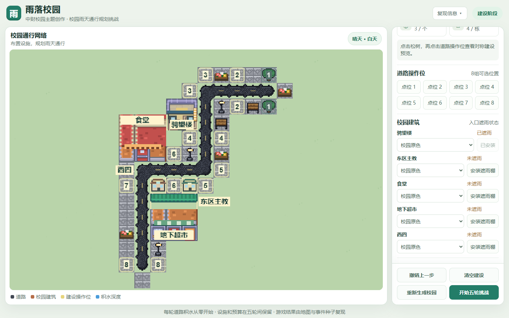

# 雨落校园

以大学校园雨天通行为主题的规划小游戏。玩家用30点预算安排树木、绿化、排水口和建筑遮雨棚，再经历五轮天气，比较安全度与舒适度。地图包含骋望楼、东区主教、食堂、地下超市和西四，以及8组建设位。



## 运行

开发验证使用Node.js 24和npm 11。在仓库根目录执行以下命令，打开终端给出的本地网址。

```sh
npm ci
npm run dev
```

## 构建网页版

```sh
npm run build
npm run preview
```

构建结果位于dist。完整复制dist中的文件即可部署到静态网站。Vite配置采用相对路径，计划由个人网站在 `/games/rain-campus/` 提供试玩，网站接入和发布由网站工程负责。

## 玩法

1. 选择设施，在地图编号候选格或右侧点位列表中建设，悬停可查看整组费用。
2. 为建筑入口安装遮雨棚。预算不足或占位冲突时拒绝建设，可以撤销或清空。
3. 开始五轮挑战，观察天气、积水和事件，或跳过动画直接查看同一份计算结果。
4. 使用“优化当前方案”保留地图与天气重新调整，使用“全新挑战”开始新地图。

树木、绿化及建筑外观变体具有相同类别效果。人行道、路灯、长椅和花坛仅作视觉装饰。

## 技术与项目结构

使用Phaser 4、TypeScript、Vite，界面为原生DOM/CSS。核心地图、对称放置、天气、积水、事故和评分逻辑位于src/core，视觉布局位于src/visual，界面与场景分别位于src/ui和src/scenes。

```sh
npm run check
npm test
```

浏览器交互验收使用 `npm run test:browser`，需要本机Chrome或Edge，也可通过CHROME_PATH指定。测试使用的基线JSON已随仓库保留。Windows源码版可运行 `npm run desktop`，生成独立程序使用 `npm run package:desktop`。

## 基础与许可

工程基于 [Phaser Vite TypeScript模板](https://github.com/phaserjs/template-vite-ts) 的d1d7d58提交。校园规则、五轮模拟、建设交互和视觉布局是本项目的实现。模板原始MIT声明保留在LICENSE。

Phaser引擎使用MIT许可，Pulse Everyday Streets与Kenney RPG Urban素材使用CC0许可。完整许可与来源记录随public/licenses及public/assets/campus/v4发布，构建后的网页中也保留这些文件。

- [使用手册](docs/使用手册.md)
- [开发及算法说明](docs/开发及算法说明.md)
- [开源项目与素材授权](docs/开源项目和素材授权.md)
- [素材明细](docs/素材来源与授权_V4.md)

## 已知限制

主要面向桌面浏览器，手机端尚待实机验收。小屏下需滚动，建筑细节较小。部分拥挤地图采用小规格建筑并显示完整牌匾。综合分为游戏规则下的安全与舒适评价。地图为校园主题示意布局。
